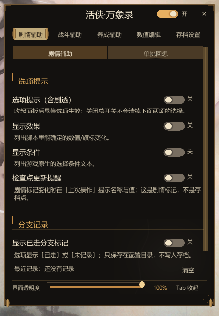

# 活侠·万象录（MortalHelper）

《活侠传 / Legend of Mortal》的辅助 Mod：面板式开关 + 选项后果提示 + 战斗/养成辅助 + 数值编辑 + 随时存档。

- **不改游戏文件**：只读写游戏运行时数据与存档旁边的小附档，随时可卸载。
- **面板**：`Tab` 展开/收起，七个页签，界面支持 简体中文 / 繁體中文 / 日本語 / 한국어。
- **默认全部关闭**，需要哪个开哪个；每个开关下面都有一句人话说明它会做什么。



---

## 功能一览

### 剧情辅助（剧情页）
- **选项后果提示**：把"选完会怎样"写在选项后面。三档——`关` / `悬停`（收起面板后鼠标停在选项上才显示）/ `总是`（直接写在选项文字里）。
- **显示范围**：`简洁` 只写数值与好感；`完整` 另外写解锁条件、剧情标记与分支去向（含剧透）。
- **解锁条件**：锁住的选项会说明差什么；只有"单一属性对固定值"这类条件支持 **一键设为**（写入当前进度，不改已保存的存档文件）。
- **单挑回想**：记录本场单挑的实际对白，最多 500 条，不暂停战斗。

### 战斗辅助（战斗页）
- **单挑七项**：主角生命不减、气力不减、闪避拉满、必定命中、必定先手、造成伤害为零（与一击必杀互斥）、一击必杀。
- **群战六项**：主角生命不减、友军生命不减、气力保持满、技能无冷却、冻结剩余时间、敌方受伤即倒地。
- 都会保留剧情强制结果与演出，不会把战斗改成必然秒过。

### 养成辅助（养成页）
- 无限日常行动点、最高好感（只对已登场角色）、练功/锻造炼丹不消耗、**一次完成一级**、解除修炼点数上限。
- **称号**：替换游戏里显示的称号（只改外观，剧情判定与称号数值不受影响），并记录你获得过的称号。
- **人际关系**：好感数值编辑与"心上人"指定（不补齐结缘剧情）。

### 数值编辑（数值页）
- 属性（白名单内的 26 项）、物品数量、银两等直接改值；每项都会写进"修改记录"，可查看。
- **游戏速度**：0.25～5 倍（原生暂停与慢动作仍由游戏自己管理）。
- 只在自由活动且关闭游戏内菜单时生效，避免改到正在结算的数值。

### 存档设置（存档页）
- **随时存档**（需先在这里开启）：剧情可以在**任意台词、选项、骰子等待页**存档；单挑存的是**这场战斗的开头**，读档后会从这场战斗重新开始。动画、群战与恢复过程中不可用。
- **存档格数**：2～999（只影响列表里建多少格，不动已有存档文件）。
- **槽位备注**：在游戏存档列表点一个槽位，按 `F2` 写备注，备注会显示在存档标题上。
- **按最近存档排序**：`F3` 切换。
- **精确恢复（实验）**：默认隐藏，属于高级测试功能，普通使用不需要开。

### 地图 / 语言
- **地图**：崆峒派地图查看，滚轮缩放、拖动平移。
- **语言**：简体中文 / 繁體中文 / 日本語 / 한국어 即时切换；尚未翻译的长消息会回退显示简体原文。

### 快捷键

| 键 | 作用 |
|---|---|
| `Tab` | 展开 / 收起面板（可在配置里改） |
| `F2` | 给当前选中的存档槽写备注 |
| `F3` | 读档列表按最近存档排序 / 恢复原顺序 |

---

## 安装

### 前置要求
- **游戏**：《活侠传》Steam 正版，Windows x64。当前适配版本 `release_1.0.6000.5`（Steam Build 26073097，Unity 2020.3.49f1）。
- **加载器**：**BepInEx 6.0.0-be.692（Mono 版）**。IL2CPP 版不适用。

### 方式一：安装包（推荐）
1. 完全退出游戏；
2. 运行 `MortalHelper-Setup.exe`，选择游戏根目录（包含 `LegendOfMortal.exe` 的那一层）；
3. 启动游戏，按 `Tab` 看面板是否出现。

### 方式二：手动安装
1. 确认游戏目录下已有 `BepInEx` 文件夹（没有的话先按 BepInEx 官方说明装好 6.0.0-be.692 Mono 版，并至少成功启动过一次游戏）；
2. 把 `MortalHelper.dll` 放到：
   ```
   LegendOfMortal\BepInEx\plugins\cerveth.mortal.helper\MortalHelper.dll
   ```
   （直接放 `plugins\` 根目录也可以）；
3. 启动游戏。

### 首次启动后
- 配置：`BepInEx\config\cerveth.mortal.helper.cfg`
- 日志：`BepInEx\LogOutput.log`（反馈问题时请附上以 `MortalHelper` / `[Anytime]` / `[Hints]` 开头的行）
- 面板位置、大小、透明度、语言都会自动记住。

### 卸载
1. 退出游戏；
2. 删除 `BepInEx\plugins\` 下的 `MortalHelper.dll`（或整个 `cerveth.mortal.helper` 文件夹）；
3. 想恢复默认设置，可再删掉 `BepInEx\config\cerveth.mortal.helper.cfg`。

用随时存档存过的档位旁边会有 `.mha` / `.mhstart` 之类的小附档。**卸载后不用删**（游戏会正常忽略它们），但**复制、备份或移动存档时要把它们一起带走**，否则那个槽位的精确恢复材料就丢了。

---

## 安全与存档

- 不修改游戏文件，不联网，不上传任何数据。
- 写存档前会先做备份事务：写入失败自动回退；无法确认安全的存档点会**拒绝保存**，不会给出"看起来成功"的假档。
- 无法与存档配对的附档会被改名成 `.stale` 留在原地，不会被删除。
- 数值修改跟随当前存档保存；**改之前建议先正常存一次档**，方便回退。

---

## 常见问题

**Q：面板没出现。**
先确认 BepInEx 正常加载（`BepInEx\LogOutput.log` 开头应有 BepInEx 版本信息），再搜 `MortalHelper`。常见原因：加载器不是 6.0.0-be.692 Mono 版、装到了别的目录、或插件目录里还有旧辅助插件（见下）。

**Q：提示"检测到旧辅助插件"。**
本 Mod 会拒绝和已知旧辅助插件同时运行（例如 `MortalFateHelper.dll`、`LOMSave2.dll`、`DiceMaster*.dll`、`ControlMyDestiny.dll`）。把这些文件移出 `BepInEx\plugins\` 后重启即可。

**Q：随时存档是灰的 / 存不了。**
需要先在【存档设置】里打开「启用随时存档」。另外这些情况不允许存：过场与动画中、群战、正在恢复、以及当前剧情段落无法建立可靠起点。状态行会说明具体原因。

**Q：单挑存了档，读档怎么回到战斗开头？**
这是刻意的：游戏本身不保存"打到第几回合"的战斗进度，所以单挑只能从这场战斗的开头重建。剧情存档不受影响。

**Q：切到日本語 / 한국어 后有个别地方还是中文。**
长消息与诊断文本是故意回退显示简体中文的；界面标签、提示框、遮罩等已翻译。游戏自带的属性名、人物名、称号名跟随游戏语言。

**Q：会不会和别的 Mod 冲突？**
会检查已知的旧辅助插件并拒绝启动。其他 Mod 请自行测试；如果两边都实现"随时存档"，建议只留一个。

---

## 版本与文档

- 当前源码：`0.1.1` 开发候选（历史包 `v0.1.0` 不含当前修复）。
- 详细文档：
  - [验证记录](docs/VALIDATION.md)
  - [随时存档验收](docs/ANYTIME-SAVE-ACCEPTANCE.md)
  - [存档事务设计](docs/SAVE-TRANSACTION.md)
  - [界面状态说明](docs/UI-STATUS.md)
  - [实现说明](docs/IMPLEMENTATION.md)
  - [开发版 README（构建、来源与许可细节）](docs/README-DEV.md)
  - [更新日志](CHANGELOG.md)

## 许可与来源

代码以 MIT 发布，详见 [LICENSE](LICENSE)；第三方内容与界面归属见 [PROVENANCE.md](PROVENANCE.md) 与 [THIRD_PARTY.md](THIRD_PARTY.md)。参与开发请先看 [CONTRIBUTING.md](CONTRIBUTING.md)。

---

## English quick start

A panel-based helper mod for *Legend of Mortal* (活侠传): option consequence hints, combat and progression assists, numeric editing, and anytime saves.

**Requirements:** Windows x64, Steam build `release_1.0.6000.5` (Unity 2020.3.49f1), **BepInEx 6.0.0-be.692 (Mono)**.

**Install:** run `MortalHelper-Setup.exe` and point it at the game folder, or copy `MortalHelper.dll` to `LegendOfMortal\BepInEx\plugins\cerveth.mortal.helper\`. Press `Tab` in game to open the panel.

**Config:** `BepInEx\config\cerveth.mortal.helper.cfg` · **Log:** `BepInEx\LogOutput.log`

**Uninstall:** quit the game and delete `MortalHelper.dll`. Keep the `.mha` / `.mhstart` companion files when moving saves between machines.

The panel is available in Simplified Chinese, Traditional Chinese, Japanese and Korean.
